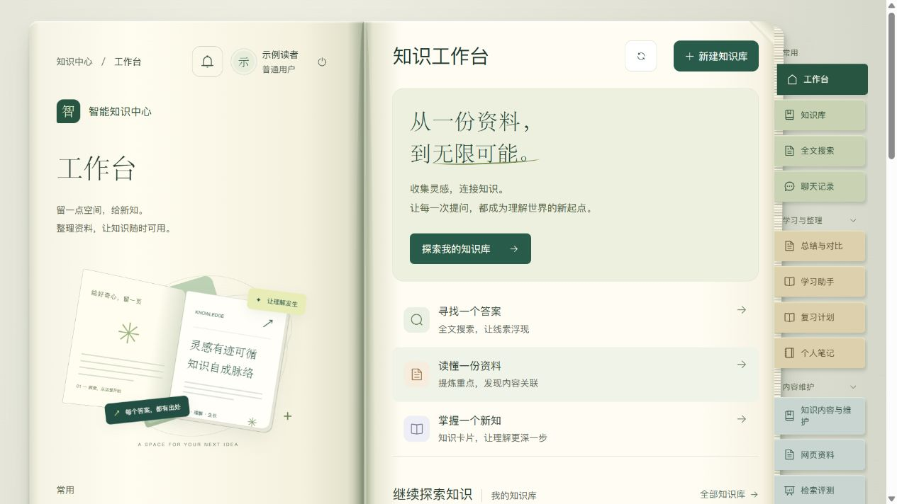
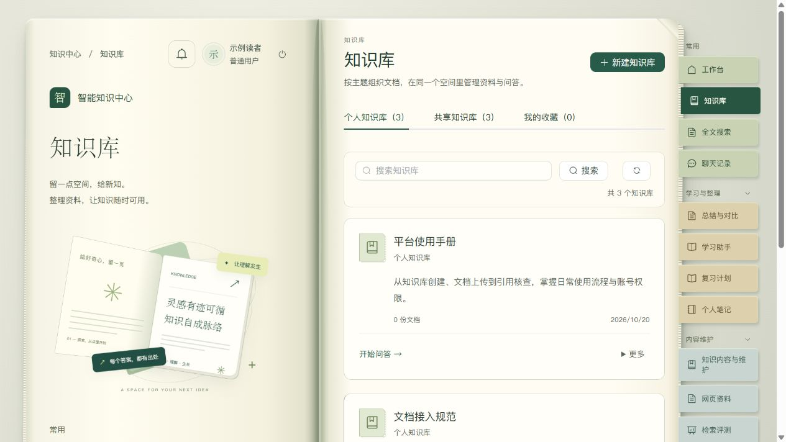
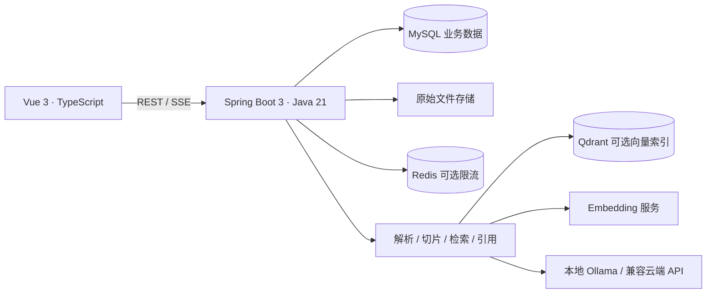

# AI Knowledge Hub

基于 Vue 3 + Spring Boot + RAG 的知识管理与问答系统，支持文档上传、索引处理、流式问答、引用原文、会话恢复和按账号授权访问。

## 项目亮点

- **可追溯问答**：文档解析、切片、检索、SSE 流式输出与原文引用，支持停止生成及历史恢复。
- **权限与协作**：知识库成员角色、私有/共享内容、修改建议审核、版本恢复与私人笔记隔离。
- **可切换模型**：本地 Ollama 和兼容 API 的云端模型，生成、Embedding 与向量存储独立配置。
- **可验证实现**：后端集成测试、前端组件测试及 Windows 启动回归；GitHub Actions 自动测试和构建。

## 界面预览

以下截图于 2026-10-20 从当前版本实际运行界面截取，展示书本式布局与书签导航。使用独立示例账号和三个空的示例知识库，不包含私人资料；窗口大小会影响布局，静态截图不展示翻书动效。



<details>
<summary>查看书本入口与知识库</summary>




</details>

## 技术架构



没有配置生成模型时提供标明模式的原文检索；hash 向量不等同于语义 Embedding。系统不会把模型调用失败伪装成生成成功。详细边界见 [RAG 设计](docs/rag.md)。

## 文档导航

| 文档 | 内容 |
| --- | --- |
| [部署与运行](docs/deployment.md) | 环境配置、启动方式、验证命令 |
| [共享与协作](docs/collaboration.md) | 收藏、分享、修改建议审核与版本恢复 |
| [系统架构](docs/architecture.md) | 模块职责与数据流 |
| [API 参考](docs/api.md) | 认证、权限、流式问答与扩展接口 |
| [数据库说明](docs/database.md) | 初始化、版本保留与备份 |
| [RAG 设计](docs/rag.md) | 入库、检索、切片与上下文预算 |
| [本地 AI](docs/local-ai.md) | 可复现的 Ollama 安装、配置与验证 |
| [公开仓库说明](docs/github-readiness.md) | 提交范围、验证结果与授权状态 |
| [功能扩展](docs/feature-update-2026-09-20.md) | 知识工具与能力边界 |

根目录的《完整开发文档》和 `docs/superpowers/` 保留设计与实施历史；当前使用方法以本页及上述专题文档为准，计划中的功能不代表已经实现。

## 当前状态

代码目录：`vue/` 存放前端，`SpringBoot/` 存放后端，`sql/` 统一存放数据库 SQL 脚本。后端 Java 实体、Mapper 和数据库升级逻辑仍属于后端代码。构建时自动将所需 SQL 加入后端资源；请保持这三个目录位于同一项目根目录。

工作台显示当前账号实际可访问的知识库与统计数据。内置资料可通过认证接口导入为三个可维护的知识库：平台使用手册、文档接入规范、开发接口知识库。文档、索引与会话持久保存，可继续上传自己的资料。

## 共享与协作

支持公开/私有知识库、分享链接、收藏筛选，以及知识条目的修改建议审核、修改前后对照、贡献记录和版本恢复。公开内容需登录阅读，私有库仍可按成员角色协作。管理员也可创建私有库。入口与边界见 [共享与协作](docs/collaboration.md)。

## 知识工具

新增全文搜索、问答反馈闭环、团队角色、文档版本与回收站、FAQ/术语/阅读顺序、检索实验室、网页导入、可选 PDF OCR 和间隔复习。入口、部署配置与能力边界见 [功能扩展说明](docs/feature-update-2026-09-20.md)。

- **文档总结与对比**：从侧边栏或知识库详情进入，选择 1～5 份文档总结，或 2～5 份文档对比，可填写关注点。结果自动保存，也可存为个人笔记。仅可选择已处理完成的文档；长资料会显示实际使用范围。
- **学习助手**：选择资料生成知识卡片和 3～10 道选择题，提交后查看评分与解析；错题自动保存，可标记已掌握或重新练习。学习记录和提交记录保存在服务器。
- **个人笔记**：支持新建、分类、搜索、Markdown 编辑和预览。回答、总结与知识卡片可以保存为笔记。笔记仅本人可访问，管理员也不能查看他人的私人笔记。
- **更新提醒**：在知识库详情点击「关注更新」，之后的文档上传、重新索引、处理成功或失败、删除会显示在站内提醒中。支持未读角标、仅看未读和标记已读；取消关注后不再收到新提醒。未读数量每分钟刷新，列表支持手动刷新；不发送邮件或系统通知。

这些功能沿用已有 AI 配置。未配置语言模型时，总结/对比明确展示原文整理，学习助手提供原文卡片与填空练习；已配置模型时生成分析与学习内容。模型不可用或返回格式不合法时显示失败，保留所选资料供重试。总结、对比与学习内容最多使用 20,000 字符的已解析资料，页面会说明实际覆盖范围。

新增数据表由启动时的增量建表自动创建，现有文档和会话不会被清空。`sql/schema.sql` 包含完整建表语句，`sql/notes.sql`、`sql/intelligence.sql`、`sql/notifications.sql` 为各模块的独立建表脚本。

## 环境要求

- Node.js 20+
- Java 21（通过 `JAVA_HOME` 或 PATH 配置）
- Maven 3.9+
- Docker Desktop（可选，用于 MySQL/Redis/Qdrant/MinIO）

## 快速启动（Windows）

推荐在项目根目录运行一键脚本，它会加载 `.env` 并处理基础服务、依赖安装和端口选择：

```powershell
.\start-dev.ps1 -OpenBrowser
```

也可以双击 `start-dev.bat`。首次启动和恢复行为见下方说明。

### 手动启动

手动运行 Maven **不会自动加载根目录 `.env`**。以下步骤使用代码中的开发默认值；如果修改了数据库账号、密码或模型配置，需先将相应变量设置到后端终端的进程环境中。需要完整加载 `.env` 时优先使用一键脚本。

```powershell
if (-not (Test-Path .env)) { Copy-Item .env.example .env }
docker compose up -d mysql redis qdrant
```

后端：

```powershell
$env:JAVA_HOME='C:\path\to\jdk-21' # 替换为本机 Java 21 安装目录
$env:Path="$env:JAVA_HOME\bin;$env:Path"
$env:MYSQL_PORT='3307' # 与 MYSQL_DOCKER_PORT 一致，区别于容器内部的 3306
cd SpringBoot
mvn spring-boot:run
```

前端另开终端执行：

```powershell
cd vue
npm ci
npm run dev
```

### 一键脚本行为与参数

Windows 下直接双击根目录的 `start-dev.bat`：检查项目和开发工具，必要时启动 Docker Desktop，构建并启动前后端，待页面可访问后自动打开浏览器。重复双击会打开已运行的系统；启动中再次双击会提示等待。失败时窗口保留错误信息，日志位于 `.runtime/`。需要先安装 Java 21、Maven、Node.js 和 Docker Desktop；脚本不会自动安装这些工具。

如果前端或后端单独退出，再次运行启动脚本会保留健康服务，并在原端口补启动缺失服务。恢复端口被其他进程占用时会明确提示端口号。启动脚本回归测试可运行 `powershell -NoProfile -ExecutionPolicy Bypass -File scripts/test-startup.ps1`，测试使用模拟进程，不会停止实际服务。

```powershell
.\start-dev.ps1
# 无外部模型时使用原文检索（保留历史参数名）
.\start-dev.ps1 -DemoAi
# 使用自己已经配置好的数据库等服务，跳过 Docker 启动
.\start-dev.ps1 -SkipInfrastructure
# 在 PowerShell 中启动后自动打开浏览器
.\start-dev.ps1 -OpenBrowser
```

首次运行会从 `.env.example` 创建缺失的 `.env`，并在缺少 `vue/node_modules` 时执行 `npm ci`。默认启动 MySQL、Redis 和 Qdrant，后端数据库连接自动使用 `MYSQL_DOCKER_PORT`（默认 `3307`）；`-SkipInfrastructure` 则保留 `.env` 中的数据库连接配置。MinIO 是可选服务，本脚本不启动它。中文目录下自动选择有效的 Compose 项目名，检测到现有容器时沿用其项目名和数据卷。

前端默认仅本机访问，地址为 `http://127.0.0.1:5173`；端口冲突时以脚本输出为准。后端构建日志在 `.runtime/backend-build.log`，运行日志在 `.runtime/backend.log` 和 `.runtime/backend-error.log`，前端日志在 `.runtime/frontend.log` 和 `.runtime/frontend-error.log`。重复启动会复用健康进程；修改代码或 `.env` 后，需要先停止对应进程，再运行脚本。

脚本启动后会打印实际访问地址；日志和进程信息保存在 `.runtime/`。容器部署使用 `docker compose up -d --build --wait`，Web 默认端口为 `8088`，可通过 `.env` 中的 `WEB_PORT` 修改。

首次初始化账号：`student / 123456`；管理员：`admin / 123456`。登录页不展示或预填密码。正式使用前在个人中心修改初始密码，部署时配置独立 JWT 密钥和数据库密码。完整架构、API、RAG 和部署说明见 `docs/architecture.md`、`docs/api.md`、`docs/rag.md` 和 `docs/deployment.md`。

这些演示账号仅在 `dev` 模式的空数据库中创建。正式部署使用 `.env.production.example` 和 `prod` 模式，默认不创建账号；首次管理员设置见 [生产部署](docs/deployment.md#生产部署)。Compose 的 Web、数据库及辅助服务端口默认只绑定本机，公网访问需配置 HTTPS 反向代理。

## 验证

在 `SpringBoot/` 执行 `mvn test`；在 `vue/` 执行 `npm run test -- --run` 和 `npm run build`。启动脚本验证见上文，运行中系统的验证脚本见 [部署与运行](docs/deployment.md#可重复验收)。

## 注册账号使用说明

新用户可以在登录页点击“创建账号”，或访问 `/register`。注册成功后自动进入工作台，角色为普通用户，可以创建自己的知识库，并读取共享库；受邀后可按成员角色访问团队知识库。会话和私人笔记按账号隔离。已有账号可从注册页返回登录。

## 导入三个知识库

启动系统后在项目根目录执行，将账号和密码替换为实际账号。资料归导入账号所有，管理员也能管理。

```powershell
$env:KNOWLEDGE_API_URL='http://127.0.0.1:8080/api' # 使用实际后端端口
$env:KNOWLEDGE_USER='你的账号'
$env:KNOWLEDGE_PASSWORD='你的密码'
node scripts/import-workspaces.mjs
```

脚本通过正常上传与索引流程导入 `knowledge-data/workspace/` 下的资料。重复执行复用同名知识库和同名文件，不覆盖用户内容。处理失败时可在文档页面修复并重建索引后重试。结果写入 `output/workspaces.json`。

使用相同环境变量执行 `node scripts/verify-workspaces.mjs` 可检查三个知识库的回答、引用归属、历史恢复和原文件下载；会发起三次问答并保留会话，启用在线模型时会产生相应服务用量。

认证后的 `GET /api/system/status` 返回 LLM、Embedding、向量库和 Redis 模式。语言模型、Embedding 和向量存储分别配置：启用模型向量需要设置 `EMBEDDING_ENABLED=true` 及对应地址、模型和密钥；启用 Qdrant 存储还需设置 `QDRANT_ENABLED=true`。实际模式取决于启动配置，不应根据某台机器的 `.env` 推断其他环境。Ollama 本地模型配置见 [本地 AI 说明](docs/local-ai.md)。

导入脚本不会覆盖同名资料。修改 `knowledge-data/workspace/` 后，已导入的知识库需要上传新版本才会使用新内容；仅重新索引仍读取服务器保存的旧文件。

## 授权状态

当前尚未选择开源许可证，本次整理不新增第三方复用授权。依赖项目保留各自许可证；发布到 GitHub 前后的授权决定由项目作者另行明确。
