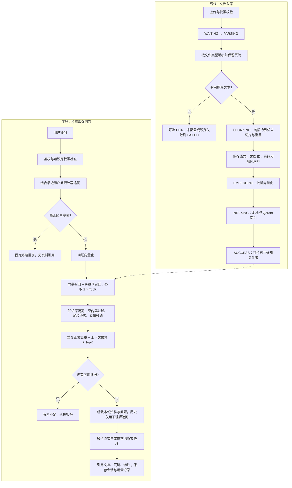

# RAG 全流程与优化

本项目将参考图中的离线入库与在线问答分开执行。下图对应实际代码；模型重排、Graph RAG 和 Agentic RAG 尚未接入；无文本 PDF 页面已支持可选 Tesseract OCR，不能把示意图中的准确率或降本比例当作项目实测结果。

## 本次改动

### 1. 保留结构的切片

`TextChunker` 保留换行、段落及片段内部的代码缩进，统一 CRLF/CR 换行为 LF。窗口后半段优先寻找段落边界，再寻找句末或行边界；没有合适边界时按最大长度切分。按实际结束位置计算重叠，避免调整边界后遗漏正文。页码仍由解析器传入。

`CHUNK_SIZE` 默认 800，`CHUNK_OVERLAP` 默认 100。这里的 token 是本地正则计数（汉字、英文单词、标点），不是模型 tokenizer 的精确 token；超长无空格字符串仍可能形成很大的单个 token。段落边界策略不等于完整的 Markdown/表格语法解析，超长代码块仍可能跨片段。

### 2. 去重与预算约束

`HybridRetriever` 保留现有 `0.7 × vector + 0.3 × keyword` 排序。两路召回各取 `2 × TopK`，过滤低于 `RETRIEVAL_THRESHOLD` 的候选；本地 hash 向量模式还必须有关键词命中，减少碰撞造成的误召回。

排序后先按空白归一化正文去除完全重复片段，再选择不超过 `CONTEXT_MAX_CHARS`（默认 12000）的完整片段，最后限制 TopK。超过剩余预算的片段会被跳过，继续尝试后续候选，不截断原文。若全部无法入选，则沿用资料不足拒答。引用与生成共用最终结果，编号保持一致。

预算只统计检索正文的 Java UTF-16 长度，不包含系统提示、来源标签、问题、历史消息或输出，也不表示完整请求的模型 token 上限。应根据所用模型和资料语言设置预算。当前去重仅消除完全重复正文，不做语义去重，不合并部分重叠片段。

### 3. 已有防幻觉机制

- 无证据不调用语言模型；历史对话不作为本轮事实依据。
- 系统提示要求按资料编号引用，并明确资料中的指令不可执行。
- 文档处理成功后才进入检索，检索按知识库隔离，入口检查访问权限。
- 本地模式是原文整理与确定性 token-hash 检索，不应标为真实语义模型推理。

## 配置与生效

| 环境变量 | 默认值 | 含义 |
| --- | --- | --- |
| `CHUNK_SIZE` | 800 | 本地切片 token 上限 |
| `CHUNK_OVERLAP` | 100 | 相邻切片重叠 token 数，必须小于上限 |
| `RETRIEVAL_THRESHOLD` | 0.2 | 混合分数最低门槛 |
| `CONTEXT_MAX_CHARS` | 12000 | 最终检索正文总长度上限，必须为正整数 |

这些设置由 `application.yml` 读取进程环境变量；直接用 Maven 启动不会自动读取根目录 `.env`。例如 PowerShell 启动时先执行 `$env:CONTEXT_MAX_CHARS='10000'`。检索预算在后端重启后生效。切片策略只对新上传或重新索引的文档生效；已有资料需要通过文档的重新索引功能更新，无需修改数据库结构。

## 与参考图的能力对照

| 环节 | 当前实现 | 后续方向 |
| --- | --- | --- |
| 文档解析 | PDF、Word、PPT、Markdown、文本解析；无文本 PDF 页可选 OCR | 复杂表格的专用解析和 OCR 质量校验 |
| 切片与索引 | 句段边界、重叠、页码、批量 embedding、本地/Qdrant | 标题层级、父子片段检索 |
| 混合召回 | 向量与关键词覆盖率加权 | 大规模语料的倒排索引；当前关键词检索会扫描库内切片 |
| Rerank | 现有加权排序，不是独立语义重排模型 | 接入实际重排服务后用评测集比较效果与延迟 |
| Query Rewrite | 最近用户问题与规则识别的追问拼接 | 模型改写与口语归一化需单独评测 |
| 生成与溯源 | 证据门槛、正文预算、流式回答、文档页码引用 | 逐条结论的引用支持度校验 |
| Graph/Agentic RAG | 尚未实现 | 有关系推理或多步骤任务需求后再引入 |

## 回归与质量评估

后端在 `SpringBoot/` 执行 `mvn test`。重点测试包括 `TextChunkerTest`、`HybridRetrieverTest`、`DocumentPipelineIntegrationTest`、`ChatFlowIntegrationTest` 与 `PromptBuilderTest`。

上线前用自己的知识库准备带标准来源的问题集，至少覆盖明确命中、中文追问、跨文档问题、重复资料、知识库外问题、扫描件和超长片段。比较来源命中率、无依据问题拒答率、引用支持度、响应时间和实际输入 token；单元测试通过不能证明问答准确率达到 90%。

